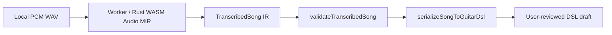

<!-- agent-doc-type: design -->
<!-- agent-doc-schema: 2 -->

# 音声採譜設計 (Audio Transcription)

- Status: Draft
- Owning Issue: [Issue #118](https://github.com/puchinya/vscode-guitar-dsl/issues/118)
- Related Issue: [Issue #164](https://github.com/puchinya/vscode-guitar-dsl/issues/164)
- Related specification: [Extension specification](../specs/extension.md), [GuitarDSL syntax specification](../specs/guitardsl-syntax.md)
- System context: [Architecture](architecture.md)

## Context and goals

ローカル WAV の Audio MIR 採譜を、Worker / WASM の入力解析経路と共通の Music IR 検証・GuitarDSL 出力経路に分けて記録する。生成文書は編集可能であり、規範動作は拡張機能仕様が所有する。

## Requirements traceability

| 仕様上の要件 | 対象 |
|---|---|
| ローカル音声採譜、処理境界、キャンセル | 拡張機能仕様 §3.8 |
| melody / syllable lyric 出力形式 | 言語構文仕様 §12–§13 |

## Architecture

- **ローカル Audio MIR**: `wasm/crates/audio-mir/` の Rust/WASM コアと `src/audioMir/` の Worker / host adapter がローカル PCM WAV を扱う。VS Code desktop のローカル extension host を対象とし、web extension / remote extension host は対象外。API key やネットワークを使わない。
Audio MIR adapter は Music IR validator で入力を厳密に検証し、serializer が検証済みデータだけから DSL を決定論的に生成する。音節歌詞の生成・正規化は `src/melody.ts` と共有 `src/transcription/serializer.ts` が担う。出力を `parseGuitarDsl()` で再検証し、診断がない場合だけ新しい未保存 GuitarDSL 文書を開く。採譜精度を示す承認済み受け入れ閾値は記録されていないため、構造検証は推定音楽内容の正しさを保証しない。

### ローカル Audio MIR pipeline

WAV decoder は PCM 全体を複製保持せず逐次読む。WASM 側は有界 rolling STFT、HPSS、chroma / onset 特徴量、beat / chord / rhythm 推定を順につなぎ、キー推定値は metadata として返す。拡張用の段階 API では `Analysis` が model 入力 log-mel の chunk を公開し、Worker 内の Beat This! WASM model が chunk ごとの logits を返す。残りの特徴量と logits をまとめて最終 JSON を構成し、安定した error code を JS 境界へ返す。

採譜結果は `TranscribedSong` JSON 形式へ変換される。評価用の生音声や参照データを配布物に含めないというリポジトリの制約は維持する。

Classic の `tempo.confidence` は、最終選択された BPM に対する候補スコアの相対差である。BPM 比が 1× 近傍の `[1.0, 1.02]`、2× の `[1.96, 2.04]`、または 3× の `[2.94, 3.06]` に入る候補は等価クラスとして競合から除き、最も高い独立候補とのスコア差を正規化する。独立候補がない場合の `1.0` は、この候補集合に比較対象がなかったことを示し、BPM の正しさを示す確率ではない。Beat This! / Neural の confidence は、拍間隔が中央値の ±10% 以内にある割合を示す区間安定度であり、Classic の相対スコア差とは異なる指標である。どちらの confidence も記録・ログ用で、テンポの選択、受理・拒否、Neural から Classic への fallback 判定には使わない。

## Data flow and ownership

Audio MIR adapter はローカル推論結果を IR 形式へ変換する。IR validator が後続処理への境界を持ち、serializer は有効 IR から DSL を決定論的に生成する。ユーザーのファイル選択と解析が成功した場合のみ、新しい未保存文書を作成する。

## Failure handling

WAV の読み込み、Worker / WASM 解析、Music IR 検証、シリアライズ、GuitarDSL 再解析の失敗は分類済みエラーとして返す。キャンセル時は処理を止め、文書を作成しない。strict validator / serializer は不正な IR を出力 DSL に通さない。

## Alternatives considered

ローカル解析だけを提供し、クラウド認識器は含めない。共有 Music IR と serializer は Compiler / Interchange / Guitar Pro からも使うため、採譜専用に再設計しない。

## Verification strategy

Audio MIR Worker / WASM / strict IR validator / serializer、音節歌詞再解析の既存テストで境界を確認する。検証は Issue #164 の変更内容と拡張機能仕様のゲートに従う。
