<!-- agent-doc-type: specification -->
<!-- agent-doc-schema: 2 -->

# GUI 画面仕様書 (GuitarDSL GUI Screen Specification)

- Status: Current
- Owning Issue: [Issue #150](https://github.com/puchinya/vscode-guitar-dsl/issues/150)
- Related Issue: [Issue #137](https://github.com/puchinya/vscode-guitar-dsl/issues/137)
- Related Issue: [Issue #158](https://github.com/puchinya/vscode-guitar-dsl/issues/158)
- Related Issue: [Issue #164](https://github.com/puchinya/vscode-guitar-dsl/issues/164)
- Related Issue: [Issue #172](https://github.com/puchinya/vscode-guitar-dsl/issues/172)
- Related specification: [拡張機能仕様](extension.md)
- Related specification: [Web application specification](web-app.md)

## Purpose

本書は、GuitarDSL 拡張機能が独自に表示する現行画面と Issue #172 の Web Compact Workspace の構成、要素の順序、代表状態を規定する。各画面の全表示内容を独立した SVG に描き、図中の数値と文言はその画面状態を説明するサンプル値とする。Web application の編集・保存・アクセス可能性は [Web application specification](web-app.md) が所有する。

## Scope

対象は GuitarDSL のサイドバー、Preview、Inspector、コード図エディタ、ローカル WAV 採譜の導線、および Web Compact Workspace である。VS Code のタイトルバー、アクティビティバー、標準サイドバー、ステータスバー、ブラウザー外枠など、対象画面ではない周辺 UI は図に含めない。VS Code 標準の Quick Pick、Input Box、ファイルダイアログ、通常のテキストエディタも独立した画面図にはしない。

各 SVG は対象画面だけを描く独立したベクター図であり、スクリーンショットを貼り込んだものではない。矩形、線、パス、円、文字などで画面を表現する。画面内に縦スクロールがある場合は、図の高さをスクロール内容の末尾まで延ばして、その代表状態の全項目・全操作を含める。横幅からはみ出す操作列も図の幅に含める。表示領域の端で対象要素を切らない。

表の幅と高さは SVG の出力寸法を示す。これは VS Code の固定ウィンドウ寸法や Webview の CSS 寸法を規定するものではない。Preview の譜面、候補値、文書依存の表示はサンプル文書に対する代表状態であり、任意長の文書や実行中の全状態を固定するものではない。テーマ色は現在の代表表示に合わせた例であり、テーマ選択の規範ではない。

## 画面一覧

| 画面 | SVG | 出力寸法 | 図に含める表示内容の末尾 |
|---|---|---:|---|
| サイドバー・開始時 | [sidebar-start-here.svg](gui_design/sidebar-start-here.svg) | 300 × 390 px | 対象なしと「ヘルプ」区分 |
| サイドバー・GuitarDSL ファイル選択時 | [sidebar-current-file.svg](gui_design/sidebar-current-file.svg) | 300 × 382 px | GuitarDSL ヘルプを見る項目 |
| Preview・ページ表示 | [preview-paged.svg](gui_design/preview-paged.svg) | 640 × 930 px | 楽譜ページ下端とページ番号 1/1 |
| Preview・連続表示 | [preview-continuous.svg](gui_design/preview-continuous.svg) | 640 × 560 px | サンプル譜面の2段目の五線譜 |
| Preview・Practice 有効 | [preview-practice.svg](gui_design/preview-practice.svg) | 640 × 650 px | 練習行、2段目の五線譜を含む譜面 |
| TextEditor・Preview編集・変数Inspector | [bidirectional-editor-overview.svg](gui_design/proposals/issue-158/bidirectional-editor-overview.svg) | 1950 × 1110 px | 常設の通常 / 編集 / 練習セレクター、排他的な編集ドックとPracticeガイド、4つのInspector上位タブ、変数表示 |
| Inspector・変数一覧と参照編集 | [variable-inspector-states.svg](gui_design/proposals/issue-158/variable-inspector-states.svg) | 1600 × 1110 px | 上位4タブ、変数一覧、定義ドラフト、参照編集の選択状態 |
| Inspector・対象文書なし | [inspector-empty.svg](gui_design/inspector-empty.svg) | 293 × 190 px | 対象文書を開く案内文 |
| Inspector・カポ / 弾きやすさ | [inspector-capo-playability.svg](gui_design/inspector-capo-playability.svg) | 293 × 900 px | 候補12と「適用」「閉じる」 |
| Inspector・初心者モード | [inspector-beginner.svg](gui_design/inspector-beginner.svg) | 293 × 850 px | 候補2の理由と「適用」「閉じる」 |
| Inspector・移調 | [inspector-transpose.svg](gui_design/inspector-transpose.svg) | 293 × 1050 px | コード対応表と「適用」「閉じる」 |
| Inspector・コード進行候補 | [inspector-progression.svg](gui_design/inspector-progression.svg) | 480 × 1360 px | 試聴設定、適用、閉じる |
| コード図エディタ | [chord-editor.svg](gui_design/chord-editor.svg) | 548 × 1260 px | DSL 行と保存操作一式 |
| Web Compact Workspace・全体 | [web-compact-workspace.svg](gui_design/proposals/issue-172/web-compact-workspace.svg) | 1600 × 900 px | ヘッダー、4 splitter、Source、Preview、Inspector、Problems |
| Web Compact Workspace・寸法と操作 | [web-compact-layout-geometry.svg](gui_design/proposals/issue-172/web-compact-layout-geometry.svg) | 1600 × 920 px | 初期寸法、境界、最小/最大値、キーボード操作 |
| Web Compact Workspace・アイコン | [web-compact-icons.svg](gui_design/proposals/issue-172/web-compact-icons.svg) | 1200 × 750 px | Web ツールバーとツールウィンドウの SVG アイコン |
| Web Compact Workspace・メニュー | [web-compact-context-menus.svg](gui_design/proposals/issue-172/web-compact-context-menus.svg) | 1340 × 780 px | Explorer、タブ、Problems、Preview のメニューと右上操作 |

## Normative requirements

各 SVG は画面一覧の寸法で対象領域の表示内容をすべて含める。縦スクロールがある画面では代表状態の末尾までを図示し、横方向にはみ出す操作列も含める。図に表示した順序、文言、サンプル状態は後続の各画面仕様に従う。

## 画面構成

### 1. GuitarDSL サイドバー

サイドバーは開始操作と、現在アクティブな GuitarDSL ファイルへの操作を提供する。文書を直接編集する画面ではない。

#### 1.1 開始時

サイドバーは1つの Tree View で、最上部に操作できない対象行を表示する。対象行はアクティブな GuitarDSL ファイル名、無題文書のローカライズ名、または「対象なし」を示す。対象行の下には「新規作成」「開く・取り込む」「編集支援」「書き出す」「ヘルプ」の5区分をこの順に表示する。初回は「新規作成」と「開く・取り込む」を展開し、残りを折りたたむ。ファイル選択時の図は手動で区分を展開した代表状態である。

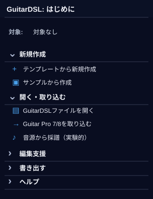

#### 1.2 GuitarDSL ファイル選択時

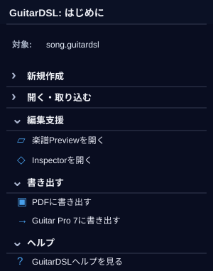

対象行にアクティブな GuitarDSL ファイル名を表示する。図では「編集支援」「書き出す」「ヘルプ」を展開し、アクティブなファイルに対する Preview / Inspector / PDF / Guitar Pro 7 の導線を示す。

アクティブなエディタが別文書へ切り替わったときに、区分の展開状態を強制変更しない。対象を使う Preview / Export 操作は、項目を押した時点のアクティブエディタだけを使う。

#### 1.3 項目・コマンド・対象

| 区分・項目 | コマンド | 対象と動作 |
|---|---|---|
| 新規作成・テンプレートから新規作成 | `guitardsl.newDocumentFromTemplate` | 選択したテンプレートから新しい未保存文書を作成する |
| 新規作成・サンプルから作成 | `guitardsl.openSample` | 選択した同梱サンプルから新しい未保存文書を作成する |
| 開く・取り込む・GuitarDSL ファイルを開く | `guitardsl.navigation.openGuitarDslFile`（内部コマンド） | `.guitardsl` / `.gdsl` だけを選び、通常の TextEditor で開く |
| 開く・取り込む・Guitar Pro 7/8 を取り込む | `guitardsl.importGuitarPro` | 既存の Guitar Pro 取り込み処理を使う |
| 開く・取り込む・ローカル WAV から採譜 | `guitardsl.transcribeAudio` | ローカル WAV のファイル選択を直接開く。取消時は解析を開始しない |
| 編集支援・楽譜 Preview を開く | `guitardsl.navigation.showPreviewActive`（内部コマンド） | 実行時にアクティブな GuitarDSL 文書を明示する。対象なしでは何も出力しない |
| 編集支援・Inspector を開く | `guitardsl.openInspector` | 既存 Inspector の対象解決と空状態を使う |
| 書き出す・PDF に書き出す | `guitardsl.navigation.exportPdfActive`（内部コマンド） | 実行時にアクティブな GuitarDSL 文書だけを `guitardsl.exportPdf` に渡す |
| 書き出す・Guitar Pro 7 に書き出す | `guitardsl.navigation.exportGuitarProActive`（内部コマンド） | 実行時にアクティブな GuitarDSL 文書だけを `guitardsl.exportGuitarPro` に渡す |
| ヘルプ・GuitarDSL ヘルプを見る | `guitardsl.openHelp` | 同梱ヘルプを開く |

サイドバーの項目・更新条件は [拡張機能仕様 §4C](extension.md) を参照する。

### 2. 楽譜 Preview

Preview は、再生操作、楽譜設定、譜面の順に表示する。ページ表示と連続表示は同じサンプル楽譜を異なるレイアウトで示す。練習モードが有効な状態では、楽譜設定行の下に練習操作行を加える。

#### 2.1 ページ表示

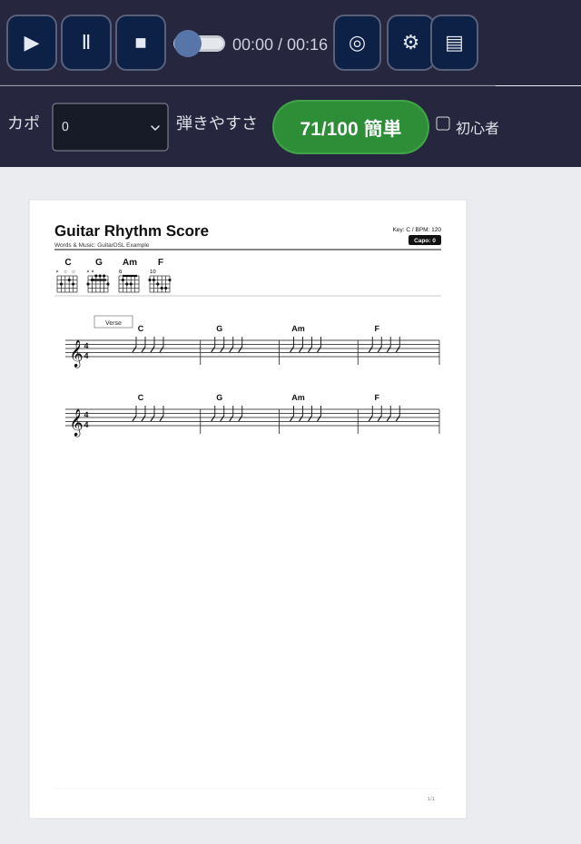

| 上からの順序 | 要素と表示仕様 |
|---:|---|
| 1 | 再生行。再生、一時停止、停止、再生位置、経過時間 / 総時間、ループ、設定、表示切替を配置する。 |
| 2 | 楽譜設定行。カポ選択、弾きやすさスコア「71/100 簡単」、初心者切替を配置する。 |
| 3 | 1ページの白い譜面面。曲名「Guitar Rhythm Score」、作者、キー C、BPM 120、カポ 0 を上部に表示する。 |
| 4 | 譜面上部のコードダイアグラム列。C、G、Am、F の図と運指を表示する。 |
| 5 | セクション「Verse」と五線譜2段を表示し、各段に C、G、Am、F のコード進行を配置する。 |
| 6 | ページ下端にページ番号 1/1 を置く。 |

#### 2.2 Web 連続表示

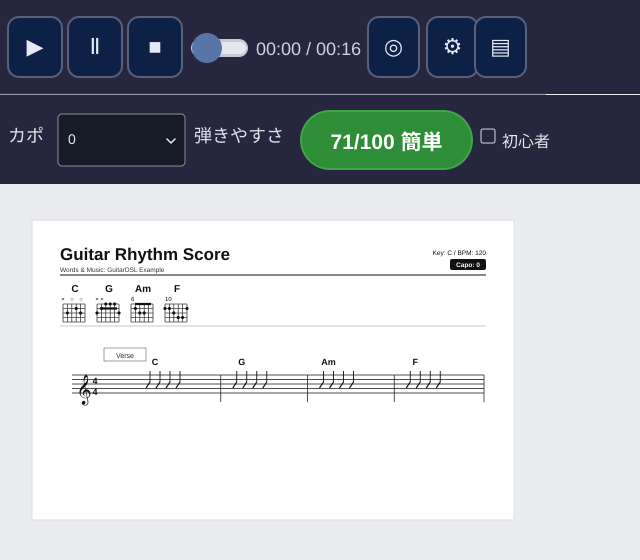

ページ表示と同じ再生行・楽譜設定行を譜面の上に置く。譜面は紙面ごとに区切らず連続レイアウトとし、曲名、作者、キー / BPM / カポ、コードダイアグラム、Verse、サンプル文書の五線譜2段をすべて図に含める。ページ境界とページ番号は表示しない。

#### 2.3 Practice 有効

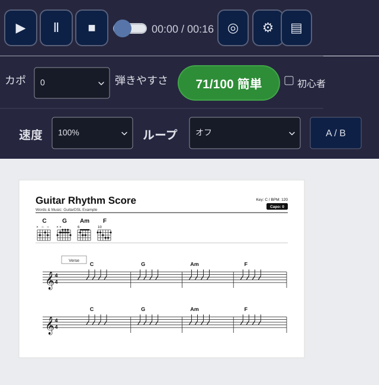

再生行と楽譜設定行の次に Practice 行を表示する。Practice 行には速度 100%、Loop オフ、A / B 操作を置く。その下にページ表示と同じサンプル楽譜の全表示内容を置き、2段の五線譜まで含める。Practice の選択状態や再生位置を譜面データの一部として描かない。

再生と Practice の操作意味は [拡張機能仕様 §4.2、§4.6、§4.7](extension.md) を参照する。

#### 2.4 弾き語り練習ガイド (Issues #153, #155, #162)

Practice が有効なときは既存の再生行、楽譜設定行、42 px Practice 操作行、ページ表示を維持し、Preview 下端に練習ガイドを置く。音楽レーン順はメロディ、歌詞、奏法、コード名、コード図とする。コンパクト表示では次コードの名前と図を常時表示し、実際のガイド幅が480 CSS px以下なら上段帯、481 px以上なら右欄へ置く。左ラベルレールは設けず、幅を割り当てない。メロディを OFF にする設定はメロディ行だけに作用し、歌詞との時間関係を保つ。

練習ガイドは Compact 専用とし、表示モード切替 UI、詳細タイムライン DOM、横スクロールを設けない。保存状態に旧詳細モードが残っていても Compact を表示し、今後の state には表示モードを保存しない。ページは前後ボタンで切り替える。練習ガイドの外側操作 UI は HTML/CSS のままにし、コンパクト4小節の番号、メロディ、歌詞、奏法、コード名、コード図、小節線、playhead は各小節1枚のSVGに描く。レーンは `<g data-guide-lane="...">` で分け、拍位置は `x = 2 + beat / measureBeats * (slotWidth - 4)` の共通変換を使う。SVG の viewBox 幅とCSS幅を実測slot幅へ合わせ、1 SVG単位を1 CSS pxにする。DSL、音源、`PlaybackTimeline`、通常譜面SVG、PDFは変更しない。

コンパクト表示は常に4小節容量を保ち、実際にある演奏出現だけを表示する。各slot幅はページ実幅 `W` を4等分し、`[W/4, W/4, W/4, W-3*(W/4)]` とする。端数は最後のslotに配分し、4slotの合計を正確に `W` とする。2bank内とbank間のCSS gapはすべて0 pxで、隣接カードは端で接する。文字列長、奏法数、コード図で幅を増やさない。小節線のみをslotの `x=0` / `x=slotWidth` に置き、拍用の内側2 px insetは保つ。320 / 360 / 400 / 421 / 480 / 481 / 600 / 601 / 840 / 1100 / 1600 CSS pxの全幅で4slotを同じ可視範囲へ収め、横overflowは1 px以下とする。コンパクト表示に横スクロールを設けない。次コード帯の名前と正方形図を含め、400 pxでも番号と全5レーンの情報を視認可能にする。

幅480 CSS px以下のCompactは次コード帯を上段に置き、下段を4小節の1列にする。幅481–600 pxは `minmax(0, 1fr) 96px`、601 px以上は `minmax(0, 1fr) 112px` とし、次コード欄を右列に置く。Compactでは4小節列と次コード欄の空白を0 pxとし、境界を0.5 CSS px以内で接続する。区切りの1 px borderは維持する。上段配置では次コード帯の下辺と4小節ページ上辺を接続し、ページ上端の8 px insetを設けない。次コード欄の内部paddingと図の寸法は維持する。固定スケールでストリップ全体を縮小せず、各カード内コード図は全演奏出現で同じ正方形サイズにする。サイズはその測定slot幅における全コード区間の最小利用幅と144 px viewBoxを上限にし、各区間中央へ置く。図laneは上下4 px以上を予約し、図全体を表示する。次コード図は44～52 pxの正方形にする。Compactの歌詞は演奏出現で選択されたverseだけを表示し、小節ごとに高さ28 pxの一段、baseline y=19、data-guide-row=0を固定する。メロディlaneは表示中に24 px ruler直後から64 pxで、歌詞有無・verse・現在歌詞テキストによって位置、高さ、pitch mapping、barのy座標を変えない。各セル幅は次の異なる歌詞開始位置、小節端、歌詞の有効durationに対応する音価幅を上限とし、音節とeventIndexで対応するメロディ音の最短横幅を考慮する。同拍の歌詞はセルを等分し、melismaでは拡張後durationを使う。同じ曲の全演奏出現で一つの歌詞font-sizeを共有する。サイズは全メロディpitch-barの最短幅 `durationBeats / measureBeats * (slotWidth - 10)` を基準にし、既存セルの安全余白0.25 pxを引いて4～13 pxへクランプする。歌詞文字列・音節・verse・bank/pageでは変えず、実slot幅が変わったときに曲全体を再計算する。各セルでは共通サイズのまま収まる先頭grapheme prefixを表示し、最初のgraphemeも収まらない場合だけ時間位置マーカーを使う。文字のtextLength、lengthAdjust=spacingAndGlyphs、scaleX、非等方transformは禁止する。一文字graphemeはセルに収まる限り実文字を表示し、複数graphemeは4 pxで収まる最大の先頭文字列を表示する。全文、ARIA名、title、event順、beat/Fractionを保持し、他verseは非表示DOMに残す。上部ヘッダーに現在歌詞の重複ラベルやテキスト欄を置かない。選択verseの歌詞はメロディ下のlyrics laneに一段で表示し、各イベントのsource text、title、ARIA名、event順、beat/Fractionを保持する。ガイド本体には横スクロールを設けない。奏法の矢印とwaveは一段の時間順で横に並べ、拍/Fractionとxアンカーを保持する。CompactのPMは矢印の下に独立した9 px太字SVG注記として置き、PMの有無で矢印のpath、x/y、自然幅を変えない。同一小節でPM attackのeventEndと次のeventStartが正確に一致する区間は一つのPM runにまとめ、非PM attack、rest、小節境界で分割する。runラベルは区間中央に置き、ラベル間に2 px未満の衝突があれば注記だけを安定順で縦に段組みする。注記行数とlane高は全演奏出現の最大値から先に決め、bank/page/fade中に変化させない。runの参加event、Fraction、ARIAとplayback stateは保持する。Compact奏法はCompact 専用の SVG geometry を使う。DOWN/UP attackとgrid4/8/16継続waveは、Contract v27に定める共通15×47 SVG masterを使う。DOWN shaft/headは `M0 0 V31` / `M-7.5 30 L7.5 30 L0 47 Z`、UPは `M0 47 V17` / `M-7.5 17 L0 0 L7.5 17 Z`、waveは `M0 0 C3.2 -3.35 5.2 -3.35 7.5 0 S12.4 3.35 15 0` とし、headはcurrentColorで塗りつぶす。waveはarrow上端からY=21pxへ置き、描画順はwaves→attacks→PMを保つ。grid8/16では参照小節幅366/400に対する `referenceScale=min(1,slotWidth/referenceMeasureWidth)` を使い、参照trackのinsetとtrackWidth=324を保ったFraction anchorへ記号を置く。SVG全体を `translate(x,y) scale(s,s)` で縮小し、path、stroke比率、Fraction、event、ARIA/titleを保ち、最小描画サイズは設けない。painted wave/arrow clearanceは1px以上、20pxのtechnique-lane gutter、10px以上のpainted technique/chord-name clearance、4小節と全コード図表示を維持する。以前の4×30 attack、5.6×30 wave、grid16三段階path、shaft 26px・stroke 1pxの表示下限は歴史的仕様であり、v24に適用しない。Compact奏法の通常/past/next/current色は順に `#1f2937` / `#475569` / `#37465e` / `#005f85` とし、白背景で4.5:1以上のcontrastを保つ。past/nextのopacityは下げず、currentは色相や太さでも区別する。歌詞の通常/current/past色は白背景に対してそれぞれ4.5:1以上のコントラストを保ち、currentとpastは明度差だけでなく色相や太字でも区別する。コード名と図は各コード区間の中央で横一列に対応させる。Compactのコード名幅はrender時の自然幅metadataからresizeごとに再計算し、狭幅から広幅へ戻す。Compactの歌詞・コード名は元の全文をデータ、`title`、ARIA名に保持する。密度超過時はセル内の表示文字だけを省略でき、現在歌詞をヘッダーに重複表示しない。音符、奏法、継続記号、コード図は省略しない。Compactメロディ休符はglyphやDOM/SVG要素を出力せず、その時間幅を空白に保ち、後続pitch barの拍位置とdurationを維持する。全compact pitch-barは直角の矩形（`rx="0" ry="0"`）にし、高さ・音高・音価・色は維持する。通常譜面SVG/PDF、DSL、playbackの休符表示・意味は変えない。

各小節SVGは小節番号、メロディ、歌詞、奏法、コード名、コード図、小節線、playheadを拍のFractionと共通x変換で描く。コード名と図はコードの有効区間の中点に揃え、同じ共有voicingから作った144×144 viewBoxの図をネストSVGで縮小する。各要素は演奏UIが必要とする小節、event、beat、verse、chordの `data-*` を維持する。幅、grid、表示切替、文書更新後の計測・SVG配置・高さ同期は、既存 `syncPracticeGuidePanelGeometry()` のRAFへまとめる。

継続記号は選択中gridに対応する各Fraction位置へ独立したSVG wave pathを描く。各記号は `data-guide-wave-grid`、拍と `n/d` Fraction、eventを保持し、同一 `(measure,event,grid,Fraction)` は重複させない。休符、mute、ghost/brush等の打音、staccatoには継続を作らない。tie開始はattackを追加せず継続waveを1つ描き、その後の有効grid位置も個別に描く。密な場合も全waveを同じ横一段に保つ。各waveのSVG形状とFractionを維持し、必要な横方向圧縮を使う。

初期表示 `[01, 02] [03, 04]`、左右2bank、演奏順 `PlaybackTimeline.occurrences`、repeat / volta / arrangement / lyricVerse、手動previous/nextは維持する。bank交替時は再生済みbankのみを同座標でopacity交差させ、現在bankのDOMとhighlightは動かさない。遷移先 `tempoBpm × effectiveSpeed()` から `fadeMs = clamp(round(60000 / effectiveBpm), 450, 900)` を開始時に計算し、不正時600 msとする。旧220 ms固定を使わず、fallback cleanupは `fadeMs + 80 ms` とする。進行中のfadeは速度変更で変えず、seek / loop / resize / mode変更 / disposeではgeneration管理で即時再投影する。reduced motion、初回表示、手動ページ移動、seek、復元、resizeは0 msとする。音声時刻・再生には影響しない。

奏法とwaveはSVG `path` 等のベクトルで描き、可視の `↓` / `↑` / `〜` をUnicode・CSS content・フォントglyphで代用しない。矢印、PM、弦番号、休符、mute、brushの既存意味は保つ。Contract v24は、以前のv5で使った4×30攻撃と5.6×30 / 3種grid16 waveを置き換える。Compactは下向きshaft/head `M0 0 V31` / `M-7.5 30 L7.5 30 L0 47 Z`、上向き `M0 47 V17` / `M-7.5 17 L0 0 L7.5 17 Z`、S波線 `M0 0 C3.2 -3.35 5.2 -3.35 7.5 0 S12.4 3.35 15 0` の15×47 SVG masterを使う。矢尻はcurrentColorで塗りつぶし、波線はmaster上端から21pxに置く。密な幅では各記号のSVG全体を縦横同じ倍率で縮小し、Fraction別のwaveと意味上のeventを保持する。v26の参照小節比例fit、stroke込みwave/arrow 1px以上、隣接wave 0.25px以上の間隔を検査し、波線・矢印の最低表示サイズは設けない。compact pitch-barは直角矩形にする。実画面検収は400/421/600/1100 px × 日英 × Light/Dark × melody ON/OFF（32枚）、400 px × grid4/8/16 × 日英 × Light/Dark（12枚）、幅400/600 pxのcompact lyric/header表示も日英×Light/Darkで撮影し、DOMRect、画面CTM、横overflow、拍アンカー/視覚位置、歌詞コントラスト、レーン位置、voicing、fade時刻を測定する。通常譜面SVG、PDF、練習ガイド、DSL、音源にはcompact変更を漏らさない。

**Contract v14（Issue #162）更新:** この節の旧grid16固定3種wave・waveとattackの非重複・1 px wave間隔・5 px inset・compactコード名の旧サイズ記述は、次のv14規則で置き換える。左右insetは2 pxとし、melody、lyrics、technique、chord、diagram、playheadは同じFraction→x変換を使う。曲内の全Playback occurrenceにpitch eventが一つもない場合だけmelody laneを0 pxにし、全occurrenceにlyric eventがない場合だけlyrics laneを0 pxにする。どこかにイベントがあれば、ページ、verse、bank fadeを切り替えても全小節でそれぞれ64 px / 28 pxを保つ。

Compact chord nameは太字で、1 chord / measureでは400 CSS pxでも24 pxを使う。複数chordでは各区間の実測可能幅に対して24 / 22 / 20 / 18 / 16 / 14 pxから最大の適合サイズを選び、14 pxでも全文が入らない場合だけgrapheme境界で省略記号を付ける。元の全文をARIAとtitleに残し、各名と図を同じ区間中央へ揃える。`400 → 600 → 400 → 1100`の再配置では元の全文とサイズ候補から再計測する。

Grid8 / grid16の各継続Fractionは独立したsemantic SVG nodeを保つ。共通15×47 SVG masterは参照小節幅366 / 400に対する referenceScale で縦横同率に縮小する。Fraction anchorは参照track inset 34 / 32、trackWidth 324から計算し、waveはanchorより5×referenceScale左を基準に置く。waveとattackのstroke込み間隔は1 px以上、隣接waveは0.25 px以上とする。密な場合だけoffsetを調整し、path、stroke比率、拍、event、ARIA/titleを保つ。Grid4とtieはCompactの既存Fraction配置を維持する。

**Contract v15（Issue #162）更新:** 上記v14規則のうち、grid8/grid16 waveの描画左端だけを`fractionAnchorX-0.90*cell`へ変更する。SVG表示幅、共通path、stroke、Fraction、card内clamp、wave同士の間隔は維持する。grid8の400 px / 600 px両方で、実画面上のwave painted boundsが自然幅4 pxの攻撃矢印boundsと交差することを検証する。Waveは背面に描き、矢印を完全に隠さず、PM・コード名・小節線には重ねない。音楽上の拍と意味上のanchorは変更しない。

**Contract v16（Issue #162）更新:** v15のwave originとwave/arrow重なり条件を置き換え、grid8/grid16の描画左端を`fractionAnchorX-0.10*cell`とする。表示幅、共通path、stroke、Fraction、card内clamp、wave同士の間隔は維持する。400 px / 600 pxの両幅で、strokeを含む各waveの描画境界と各攻撃矢印境界の水平距離を実DOMから測り、最小1 CSS px以上、接触・交差なしを確認する。Waveを攻撃記号の背面レイヤーに置いたまま、横方向には重ねない。PM・コード名・小節線にも重ねない。音楽上の拍と意味上のanchorは変更しない。

**Contract v17（Issue #162）更新:** v16の`anchorX-0.10*cell`と波線・矢印の非接触を維持する。400 px / 600 pxではgrid8/grid16ともstroke込み描画境界間に1 CSS px以上を確保する。320 px / 421 px / 480 px / 840 px / 1100 px / 1600 pxの実幅系列でも接触・交差を許さない。実幅テストにだけ挿入する同時発音用のテスト記号は、専用の配置検査を保ち、実データ由来の波線・矢印間隔測定から除く。

**Contract v18（Issue #162）更新:** compactで奏法laneとコード名laneの両方を表示するとき、奏法laneの下端からコード名文字の上端まで6 CSS px以上を確保する。余白はtemplate/live bank、ページ、grid、メロディ・歌詞の表示状態にかかわらず維持する。コード名サイズ・図の正方形寸法・図全体の表示は変えず、カード総高に6 pxを加える。練習ガイドと通常譜面には影響させない。

**Contract v19（Issue #162）更新:** compactのgrid8/grid16継続waveは、各Fractionと意味上の拍アンカーを維持したまま、表示幅を `min(cell, max(2.4, cell - 3.8))` とし、各cell内で左端を `anchorX + 0.325*cell - displayWidth/2` に置く。カード内にclampする。stroke込みのwave/attack境界は400 px / 600 pxで最低3 CSS px離し、320 / 421 / 480 / 840 / 1100 / 1600 pxでも接触させない。Waveのpath形状・高さ・stroke、矢印位置、painter order、歌詞・コード・図の各lane、v18の6 px gutterは維持する。
**Contract v20（Issue #162）更新:** v19の暫定的なwave表示幅と配置を置き換える。Grid8/grid16の波線幅は `min(cell, max(2.2, cell - 3.8))`、左端は `anchorX + cell/3 - displayWidth/2` とし、カード内にclampする。stroke込みwave/attack間隔は400 px / 600 pxで3 CSS px以上、320 / 421 / 480 / 840 / 1100 / 1600 pxでは正の値を確保する。Fraction、path形状・高さ・stroke、自然サイズ矢印と描画順、v18の6 px gutterは維持する。

**Contract v21（Issue #162）更新:** compactの奏法laneとコード名laneの間に12 CSS pxのlayout gutterを予約し、記号とコード名の実描画bounds（stroke込み）の間に最低10 CSS pxを確保する。4小節、grid4/8/16、幅320/400/421/480/600/1100/1600 px、メロディ・歌詞、bank/page/fadeで間隔を維持する。コード名・図laneとカード下端を12 px下げ、コード名適合、図寸法・完全表示、奏法高さ、時刻/Fractionと再生挙動は保つ。練習ガイド、通常譜面、DSL、PDF、音源には影響させない。

**Contract v22（Issue #162）更新:** v21の12 px gutterは、実画面で描画端間が3.65 pxに留まったため置き換える。Compactは20 CSS pxの奏法lane後余白を設け、最終描画後のstroke込み奏法boundsとコード名text boundsの間を最低10 CSS pxにする。幅320/400/421/480/600/1100/1600 px、grid4/8/16、歌詞・メロディ、ページ・bank・fadeを通じて確認し、コード図を完全表示する。練習ガイド等はv21どおり変更しない。

**Contract v24（Issue #162、responsive fitはv26で置換）:** 以前のv5およびv23の4×30矢印見本を受入基準から外し、参考画像をトレースした15×47の共通SVG masterをCompact奏法記号の正本にする。下向き矢印はshaft `M0 0 V31`（2.65px stroke）とfilled head `M-7.5 30 L7.5 30 L0 47 Z`、上向きはshaft `M0 47 V17` とfilled head `M-7.5 17 L0 0 L7.5 17 Z`。短いS波線は `M0 0 C3.2 -3.35 5.2 -3.35 7.5 0 S12.4 3.35 15 0` を矢印上端からY=21pxへ置き、stroke幅2.35pxにする。400px等の密な幅ではX方向だけ縮小し、高さ47pxを保つ。Grid8/16はセル幅に基づく従来の配置・圧縮を維持し、15幅masterの端点で3px要件を割らないよう視覚X位置を0.3 CSS px補正する。PM文字は矢印下へ置き、奏法lane高とPM位置は両bankの全カードで同じにする。v22のFraction/event、4小節、painted wave/arrow 3px以上、奏法/コード名10px以上の間隔、20px lane後余白、全コード図表示、演奏状態色を維持する。パネルの縦幅が足りない場合は小節カード領域だけを縦スクロールし、次コード欄を残したまま図全体を見られるようにする。練習ガイド、通常譜面、PDF、DSL、音源には変更を波及させない。

**Contract v25（Issue #162、Contract v26でsuperseded）:** v24の15×47 master pathはそのまま使い、responsive fitを縦横同率にする。各記号の自然幅 `naturalWidth` と配置可能幅 `usableWidth` から `s=min(1,max(0,usableWidth)/naturalWidth)` を求め、`translate(x,y) scale(s,s)` でSVG全体（strokeを含む）を縮小する。自然サイズ未満の最低描画サイズは設けず、判別できない大きさでも形状比率、拍/Fraction、event、ARIA/titleを保持する。縮小後の外接枠は同じ47px帯の中央に置く。400/600pxのwave/arrow 3px以上のpainted clearance、隣接wave 0.25px clearance、20px奏法lane余白、10px technique/chord clearance、4小節・完全なコード図を維持する。

**Issue #162 Contract v26 — 縮小時の参考画像比率（v27で同拍配置を補足）:** grid8の参照SVG小節幅366、grid16の幅400を基準に、各小節slot幅に応じて共通15×47 masterを同一倍率で縮小する。grid8は `trackInset=34`、grid16は `trackInset=32`、両方の `trackWidth=324` とし、Fraction anchorを `(trackInset + beat / measureBeats * trackWidth) * referenceScale` で配置して、参考画像の小節内余白も維持する。矢印・waveの自然幅15に対し表示幅は `15*referenceScale`。waveの描画中心は `5*referenceScale` 左へ置き、track cell幅が足りない時だけoffsetを減らし、stroke込みboundsで1pxの隙間を保つ。縮小後の判読性は要求しない。grid4とその他のlane、音楽時間、図、playback、非compact出力はcanonical v25までの条件を維持する。
**Issue #162 Contract v28（同拍グループの視覚配置）:** 同じ小節の奏法layout itemでbeat差が0.000001未満のものを同拍群とし、`(beat, eventIndex, source order)`順に置く。共有区間は最初の意味上のFraction anchorから次の異なるbeatのanchorまで（後続がなければ参照track終端まで）。n件を`stepWidth=max(0.001,(endX-startX)/n)`で等分し、rankを0から数えた基本中心を`startX+rank*stepWidth`とする。群内の記号はこの幅に収まるようSVG全体を同率縮小し、同じ一横段を保つ。通常のwave offsetとカード端clamp後も順序・非重なりを守る。隣接する描画済みboundsが重なる場合は両方のSVGを同率縮小し、再計測して衝突を解消する。各要素の意味上のbeat、Fraction、event ID、`data-guide-layout-anchor-x`は元のまま保持する。

#### 2.5 双方向編集モード（Issue #158）

Preview は既存の単一 WebviewPanel を使い、既定の「通常」、双方向編集の「編集」、練習操作の「練習」を排他的に切り替える。48 px再生行の右側 `.toolbar-actions` に通常 / 編集 / 練習のセレクターを常設する。幅600 px未満は現在値が読めるネイティブselect、600 px以上はsegmented controlを表示し、ARIA状態、フォーカスとキーボード操作を備える。旧Practice単独トグルと編集フォーム内の切替を置かない。

再生・一時停止・停止は全幅でアイコンのみを表示する。ボタンのtitleとaccessible nameは維持し、再生状態に応じて再生 / 再開へ更新する。

通常は48 px再生行と44 px楽譜設定行の下に楽譜を表示し、編集ドック・Practice行・ガイドを隠す。編集は同じ2行の下に楽譜と下端固定編集ドックを表示し、42 px Practice行と4小節ガイドを隠す。練習は同じ2行と42 px Practice行、4小節ガイドを表示し、編集ドックと編集hit-areaを隠す。編集フォームは通常 / 練習では高さ0、編集で未選択なら案内、選択時は種別別操作を表示する。編集overlayとhit-areaはPreviewにのみ存在し、PDFのSVGには出力しない。

標準 TextEditor が唯一の永続ソースである。Preview は明示した URI・文書version・Preview世代に結び付けた選択と編集 intent を送り、Host が最新テキスト、parser source binding、token種別、期待原文、音楽的整合性を検証してから一回の WorkspaceEdit を行う。1回のドラッグまたはキー確定は1 Undoとし、キャンセル、古い世代、文書切替、二重適用、解析・検証・音声停止失敗では文書を変更しない。

編集対象はauthored chord名、melody音符・休符・音価、rhythm token、単一TAB声部の弦・フレット・音価、lyrの一音節とする。省略値の継承、拍数、tie/slur、歌詞対応、TAB制約が壊れる場合は安全な明示化ができるときだけ許可し、それ以外は編集不可の理由と「コードで開く」を示す。同じソースが反復・編曲で複数表示される場合、曖昧な単一出現編集を行わない。

編集ドックとPracticeガイドは同時に表示しない。編集時はドックの高さだけを譜面の下余白に加え、練習時は既存Practiceガイドの高さを使う。どちらも幅421 / 600 / 840 / 1100 CSS pxと短い高さで本文を覆わず、末尾の譜面に到達できる。Host HTML再構築後のスクロール、フォーカス、選択は同一URI/version/generationとsource bindingに再解決できる場合だけ復元し、stale document・削除・disposeでは破棄する。同一URIの再構築ではモードを維持し、別文書またはPreview disposeで通常に戻す。

**図の位置づけ:** 追加した2枚は承認済みの純ベクター設計図であり、実装済み画面のキャプチャではない。画面一覧の元の Preview・Inspector 図は引き続き現行画面の基準とする。実 Extension Development Host の証拠は実装検収に別途記録し、設計図との差を説明する。

### 3. GuitarDSL Inspector

Inspector は対象文書がない状態と、文書に応じた設定画面を同じ領域に表示する。設定画面はタブ、説明または入力、結果、確定操作の順に構成する。

単一 Inspector の上位タブは「文書 / 変数 / 楽譜設定 / コード進行」の4ボタンを維持する。コンテンツ幅が360 CSS px以下では等幅4列にし、視覚ラベルを日本語「文書 / 変数 / 楽譜 / 進行」、英語「Doc / Vars / Score / Chords」として1行に収める。360 CSS pxを超える幅では従来の正式ラベルを表示する。狭幅でも各ボタンの `aria-label` と `title` は正式名称（日本語「文書 / 変数 / 楽譜設定 / コード進行」、英語「Document / Variables / Score settings / Progression」）を保持し、同じtab ID、ARIA状態、キーボード操作、focus表示を使う。横スクロールや省略記号でタブを隠さない。

#### 3.1 対象文書なし

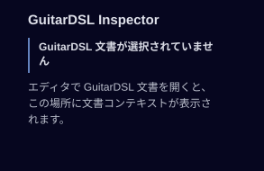

見出し「GuitarDSL Inspector」の下に、GuitarDSL 文書が選択されていない旨を2行で強調表示する。続けて、エディタで GuitarDSL 文書を開くとここに文書コンテキストを表示する説明を置く。別の開いている文書を暗黙に選択した表示は含めない。

#### 3.2 カポ / 弾きやすさ

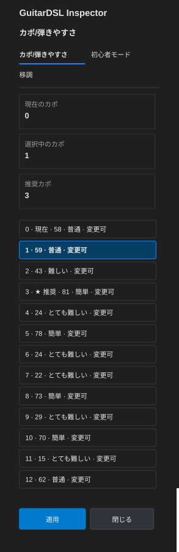

| 上からの順序 | 要素と代表表示 |
|---:|---|
| 1 | Inspector 見出しと設定タブ。「カポ/弾きやすさ」を選択し、「初心者モード」「移調」も同じタブ群に表示する。 |
| 2 | 現在のカポ 0、選択中のカポ 1、推奨カポ 3 の情報カード。 |
| 3 | カポ候補0〜12の全13行。各行に候補番号、弾きやすさスコア、難易度、変更可能状態を表示する。現在値0、選択値1、推奨値3を行内でも識別できるようにする。 |
| 4 | 候補一覧の後に「適用」「閉じる」を置く。 |

図の候補スコアは順に、58、59、43、81、24、78、24、22、73、29、70、15、62。難易度ラベルと変更可否は図に示すサンプル値である。

#### 3.3 初心者モード

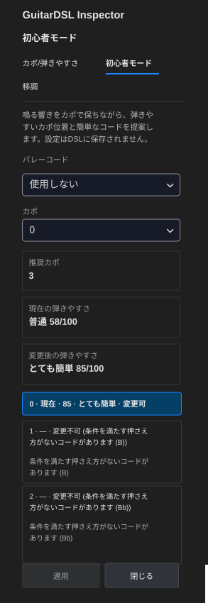

1. Inspector 見出しとタブ群を表示し、「初心者モード」を選択状態にする。
2. 鳴る響きをカポで保ちながら押さえやすい位置と簡単なコードを提案する説明を表示する。設定は DSL に保存されない旨も含める。
3. バレーコード方針「使用しない」、カポ 0、推奨カポ 3 の設定を縦に配置する。
4. 現在の弾きやすさ「普通 58/100」と変更後「とても簡単 85/100」を別の情報欄に置く。
5. 推奨カポ候補0〜2をすべて表示する。候補0は現在・変更可、候補1は B の押さえ方がないため変更不可、候補2は Bb の押さえ方がないため変更不可とし、理由文を候補に続けて表示する。
6. 一覧の後に「適用」「閉じる」を置く。

#### 3.4 移調

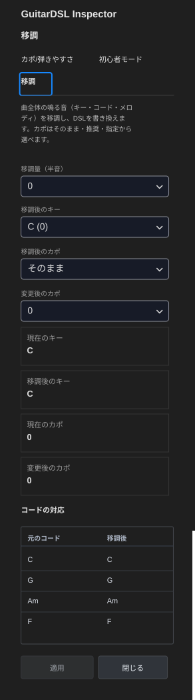

| 上からの順序 | 要素と代表表示 |
|---:|---|
| 1 | Inspector 見出しと3つの設定タブ。「移調」を選択状態にする。 |
| 2 | 曲全体の鳴る音を移調して DSL を書き換えること、カポを維持・推奨・指定から選べることの説明。 |
| 3 | 移調量 0 半音、移調後のキー C (0)、移調後カポ方針「そのまま」、変更後カポ 0 のコントロール。 |
| 4 | 現在のキー C / 移調後のキー C / 現在のカポ 0 / 変更後のカポ 0 の比較欄。 |
| 5 | コード対応表。元のコードと移調後を2列で示し、C→C、G→G、Am→Am、F→F の4行を置く。 |
| 6 | コード対応表の後に「適用」「閉じる」を置く。 |

#### 3.5 コード進行候補

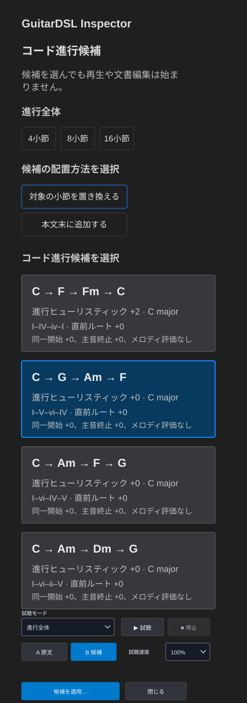

| 上からの順序 | 要素と代表表示 |
|---:|---|
| 1 | Inspector 見出し、画面見出し「コード進行候補」、候補の選択だけでは再生や文書編集が始まらないことを示す注意。 |
| 2 | 進行全体の長さ 4 / 8 / 16 小節と、配置方法「対象の小節を置き換える」「本文末に追加する」。 |
| 3 | 候補カード4枚。各カードにコード列、進行ヒューリスティックのスコアとキー、ローマ数字による進行名、評価根拠を表示する。 |
| 4 | 候補カードの後に試聴モード「進行全体」、試聴、停止、A 原文 / B 候補、試聴速度 100% を置く。 |
| 5 | 最下部に「候補を適用…」「閉じる」を置く。 |

候補カードの順序とコード列は、C→F→Fm→C、C→G→Am→F、C→Am→F→G、C→Am→Dm→G。図では2番目を選択状態にする。各カードには表示したスコアと調性、進行のローマ数字、同一開始・主音終止・メロディ評価の注記を含める。候補4枚と最下部の操作までを1枚の図に含め、スクロール領域の途中で切らない。

Inspector の設定・候補操作の意味は [拡張機能仕様 §4B、§4D](extension.md) を参照する。

#### 3.6 変数

既存の共通 Inspector に「変数」表示を追加し、現在アクティブな GuitarDSL 文書だけを対象にする。変数一覧には有効なlet定義、使用文脈、直接参照数、間接参照数、参照位置、未使用状態と診断を示す。chord定義は変数として表示しない。

Inspector の検証済みドラフトから新規作成、定義編集、名前変更、複製、未使用定義の削除を行う。「変更を適用」までは原文、Preview、PDF、音声を変えず、適用は一つの編集・一回のUndoとする。名前変更は定義と前方・後方・入れ子の全参照を一回で更新する。参照位置から元ソースへジャンプできる。

#### 3.7 Inspector 上部コンテキストタブ（Issue #158）

既存 singleton Inspector の見出し直下に「文書」「変数」「楽譜設定」「コード進行」の上部タブを1組だけ表示する。各タブは同じ Inspector 領域を切り替え、設定内の既存タブはその内側に残す。コード進行は有効な候補 session があるときだけ操作可能にし、切替だけで候補を作らない。変数 / 設定 draft の破棄確認とコード進行試聴停止が必要な場合は、確認・Stop ACK・lease 解放の完了後に遷移する。

上部タブは `role=tablist` / `role=tab` を使い、矢印キー、Home / End、Enter / Space、roving focus、`aria-selected`、`aria-controls` を実装する。全状態は日英、ライト / ダーク、狭い Inspector 幅で読めること。編集モードから開く場合は Preview が保持する文書の「変数」を初期表示する。Preview の再描画で現在のタブを再初期化しない。

Preview で変数参照を編集するときは「定義を編集（全参照）」「この箇所だけ展開して編集」「キャンセル」を明示する。後者は選択した一つのauthored参照だけが展開され、全スコアの音楽的意味が保たれるとHostが確認できる場合に限る。繰返しや編曲で複数回表示される出現、曖昧な範囲、入れ子で安全性を確定できない対象は変更しない。

### 4. コード図エディタ

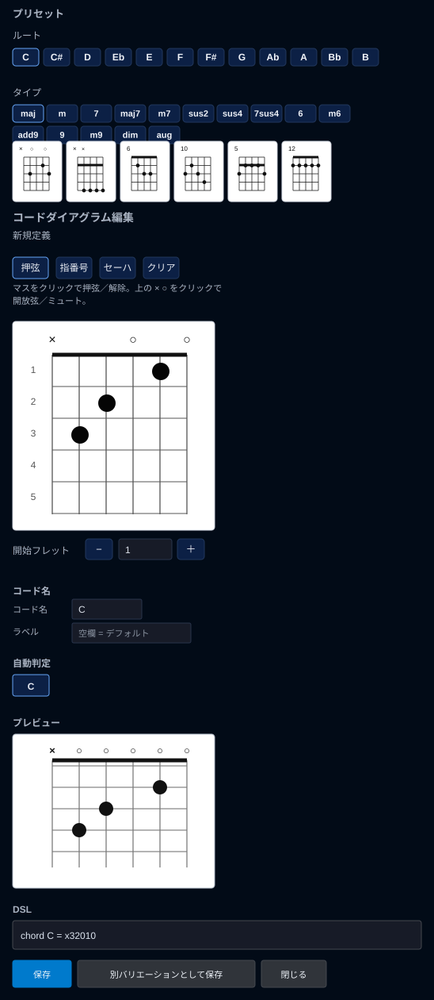

コード図エディタは上からプリセット、運指編集、コード情報、プレビュー、DSL 出力、保存操作の順に構成する。図には下記すべてを含む。

| 上からの順序 | 要素と代表表示 |
|---:|---|
| 1 | 「プリセット」見出し。「ルート」は C、C#、D、Eb、E、F、F#、G、Ab、A、Bb、B の12音を選べる。「タイプ」は maj、m、7、maj7、m7、sus2、sus4、7sus4、6、m6、add9、9、m9、dim、aug を表示する。 |
| 2 | プリセット形状候補の小型ダイアグラム列。候補の開放弦 / ミュート、押弦位置、フレット情報を図示する。 |
| 3 | 「コードダイアグラム編集」と新規定義状態。操作モードは押弦、指番号、セーハ、クリア。マス目をクリックして押弦を切り替え、上端の × / ○ でミュート / 開放弦を指定する案内を置く。 |
| 4 | 6弦のフレットボードと上端の弦状態を表示する。サンプル運指は C の x32010。 |
| 5 | 開始フレットの −、値1、＋。 |
| 6 | コード名 C、ラベル入力、空欄ならデフォルトを使う説明、自動判定結果 C。 |
| 7 | 編集中のコードダイアグラムのプレビュー。 |
| 8 | DSL 出力行 chord C = x32010。 |
| 9 | 「保存」「別バリエーションとして保存」「閉じる」の3操作を図の最下部に表示する。 |

#### 4.1 コード図内の表示規則

フレットボードは6本の弦と複数のフレット位置を直交線で表す。押弦は黒丸と指番号、ミュート弦は ×、開放弦は ○ で表す。開始フレットの値はボード直下に置く。コード名・ラベル・プレビュー・DSL はフレットボードの後に続け、保存操作はすべての編集情報の後にまとめる。

コード図の編集動作と DSL 表記は [拡張機能仕様 §3.3](extension.md) を参照する。

## 5. Web Compact Workspace

Issue #172 adds a compact desktop workspace to the browser application. The Web workspace uses CSS Grid and web-specific splitter controllers; it does not change the VS Code editor. The four proposal SVGs above are required vector references and source assets. Their music and diagnostic text are illustrative. This section owns Web screen geometry and visual hierarchy; editing, persistence, accessibility behavior, and menus are defined in the [Web application specification](web-app.md#2-application-and-document-editing).

### 5.1 Workspace geometry

At the 1600 × 900 CSS-pixel reference size, the horizontal layout is:

`Activity Bar 40 px | Explorer 220 px | splitter 6 px | center minmax(0, 1fr) | splitter 6 px | Inspector 300 px | Tool Window Bar 36 px`.

The Explorer width is adjustable from 180–420 px. The Inspector width is adjustable from 260–480 px. In Split view, the center uses a 40% Source / 60% Score ratio with minimum pane widths of 240 px and 320 px. The document tab row is 36 px. Source and Score panes have no redundant title row.

The vertical layout is a 40 px header, the resizable main workspace and Problems window, and a 24 px status bar. The header's right-side controls appear in this order: Save, PDF, Google Account, Help, Settings. The main workspace places the left Explorer and center panes beside the right Inspector. The Problems window spans Explorer, center, and Inspector; it excludes both side bars. Its initial height is 200 px, minimum is 140 px, maximum is 45% of viewport height, and its top splitter is 6 px.

### 5.2 Toolbars and display modes

The tab row holds the active document name and three icon-only workspace controls: Source (`code-2`), Split (`columns-2`), and Score (`eye`). Split is selected initially. Exactly one mode is active. Source-only and Score-only modes hide the opposite pane and the center splitter. Workspace modes are separate from the Preview's normal, edit, and practice modes.

The Activity Bar is 40 px wide and the Tool Window Bar is 36 px wide. Icon geometry comes from the 24 × 24 SVG paths in [web-compact-icons.svg](gui_design/proposals/issue-172/web-compact-icons.svg). Icons must not rely on emoji, icon fonts, raster images, or externally hosted assets. Icon-only controls have Japanese and English accessible names and titles. Selected and hover states follow the reference icon sheet.

The Explorer content shows two storage roots at once: “On this device” and “Google Drive”. Each root has an independent disclosure control, its own action row, and its own file tree. Local creation and import remain available without a Drive connection; Drive connection and folder actions stay with the Drive root. Selecting one root does not hide the other tree.

### 5.3 Splitters and narrow layouts

There are exactly four workspace splitters: the Explorer boundary, Source/Score boundary, Inspector boundary, and top of Problems. Each divider is 1 px with a 6 px pointer hit area. Pointer dragging uses capture and releases it on pointer-up or pointer-cancel. Double-click restores only that splitter's default. A focused splitter has a visible focus ring, uses `role="separator"`, exposes the orientation and current/minimum/maximum values, and accepts Arrow keys (10 px), Shift+Arrow keys (50 px), Home (minimum), and End (maximum). Bounds prevent negative or non-finite sizes and horizontal page overflow.

At narrower viewports, the Inspector collapses before the Explorer. Width-driven collapse is temporary and MUST NOT replace a manually saved open/closed preference. At 1280 × 800, the workspace remains usable without horizontal overflow. Manual close/open state, panel sizes, workspace mode, and the center ratio are restored when the browser is reopened. Corrupt values fall back to their independent defaults.

The separate Problems tool window is open by default. It has a 32 px header, error and warning counts, and close control. Its rows show type, file, line and column, and message; an empty list shows “No problems”. Diagnostic details and click behavior are owned by the Web application specification.

The [workspace SVG](gui_design/proposals/issue-172/web-compact-workspace.svg) shows the Japanese Dark 1600 × 900 layout. The [geometry SVG](gui_design/proposals/issue-172/web-compact-layout-geometry.svg) shows default sizes and keyboard resizing. The [icon SVG](gui_design/proposals/issue-172/web-compact-icons.svg) shows the 30 vector icons. The [context-menu SVG](gui_design/proposals/issue-172/web-compact-context-menus.svg) shows menu placement and header controls. Numeric values in this section take precedence over illustrative labels in the SVGs.

## Observable behavior

各図は見出しに記載した一つの代表状態を示す。スコア、コード、キー、選択行、候補数など文書や計算結果に応じて変わる値は、図のサンプル状態に限る。Preview の任意長譜面、別のキー・運指・候補、画面幅に応じた折り返し、読み込み中・エラー表示は、ここに示す図の寸法や代表値によって固定しない。

この仕様が規定するのは画面内の構成、表示順、情報のまとまりである。コマンド実行、文書変更、フォーカス、再生音、候補適用・取消の動作は [拡張機能仕様](extension.md) に従う。仕様と実装に差異がある場合、実装に合わせて既存の動作契約を変更せず、差異を Issue で解決する。

## Error and boundary behavior

入力検証、エラー表示、無効操作の扱いは [拡張機能仕様](extension.md) に従う。本書の SVG は明記した代表状態だけを示す。動的に増減する譜面・候補数・計算値や、読み込み・エラー時の全画面を一つの図で固定しない。

## Security and privacy

画面図に実在の API Key、個人の文書名、ユーザーデータを含めない。曲名、作者、コード、URL、API Key 欄の例は説明用の合成値またはプレースホルダーである。

## Verification strategy

画面仕様の図は SVG として XML 解析でき、`image` 要素やスクリーンショット画像の埋め込みを含まないことを確認する。SVG は各ファイルに記載した全寸法でベクターレンダラーを使って出力し、全17図を一覧表示して、対象画面の先頭から最下部の要素まで欠落がないことを確認する。実装画面は概念図と区別して、Issue #172 の受入条件にあるサイズ・ロケール・テーマで撮影し、DOM rectangle とともに記録する。Markdown の参照先と仕様書メタデータは `python3 -m agent_workflow validate-docs --issue 172` で検証する。
