<!-- agent-doc-type: specification -->
<!-- agent-doc-schema: 2 -->

# GUI 画面仕様書 (GuitarDSL GUI Screen Specification)

- Status: Current
- Owning Issue: [Issue #150](https://github.com/puchinya/vscode-guitar-dsl/issues/150)
- Related Issue: [Issue #137](https://github.com/puchinya/vscode-guitar-dsl/issues/137)
- Related specification: [拡張機能仕様](extension.md)

## Purpose

本書は、GuitarDSL 拡張機能が独自に表示する現行画面の構成、要素の順序、代表状態を規定する。各画面の全表示内容を独立した SVG に描き、図中の数値と文言はその画面状態を説明するサンプル値とする。

## Scope

対象は GuitarDSL のサイドバー、Preview、Inspector、コード図エディタ、YouTube 採譜パネルである。VS Code のタイトルバー、アクティビティバー、標準サイドバー、ステータスバー、ブラウザー外枠など、対象画面ではない周辺 UI は図に含めない。VS Code 標準の Quick Pick、Input Box、ファイルダイアログ、通常のテキストエディタも独立した画面図にはしない。

各 SVG は対象画面だけを描く独立したベクター図であり、スクリーンショットを貼り込んだものではない。矩形、線、パス、円、文字などで画面を表現する。画面内に縦スクロールがある場合は、図の高さをスクロール内容の末尾まで延ばして、その代表状態の全項目・全操作を含める。横幅からはみ出す操作列も図の幅に含める。表示領域の端で対象要素を切らない。

表の幅と高さは SVG の出力寸法を示す。これは VS Code の固定ウィンドウ寸法や Webview の CSS 寸法を規定するものではない。Preview の譜面、候補値、文書依存の表示はサンプル文書に対する代表状態であり、任意長の文書や実行中の全状態を固定するものではない。テーマ色は現在の代表表示に合わせた例であり、テーマ選択の規範ではない。

## 画面一覧

| 画面 | SVG | 出力寸法 | 図に含める表示内容の末尾 |
|---|---|---:|---|
| サイドバー・開始時 | [sidebar-start-here.svg](gui_design/sidebar-start-here.svg) | 300 × 390 px | 対象なしと「ヘルプ」区分 |
| サイドバー・GuitarDSL ファイル選択時 | [sidebar-current-file.svg](gui_design/sidebar-current-file.svg) | 300 × 382 px | GuitarDSL ヘルプを見る項目 |
| Preview・ページ表示 | [preview-paged.svg](gui_design/preview-paged.svg) | 640 × 930 px | 楽譜ページ下端とページ番号 1/1 |
| Preview・連続表示 | [preview-continuous.svg](gui_design/preview-continuous.svg) | 640 × 560 px | サンプル譜面の2段目の五線譜 |
| Preview・Practice 有効 | [preview-practice.svg](gui_design/preview-practice.svg) | 640 × 650 px | 練習行、2段目の五線譜を含む譜面 |
| Inspector・対象文書なし | [inspector-empty.svg](gui_design/inspector-empty.svg) | 293 × 190 px | 対象文書を開く案内文 |
| Inspector・カポ / 弾きやすさ | [inspector-capo-playability.svg](gui_design/inspector-capo-playability.svg) | 293 × 900 px | 候補12と「適用」「閉じる」 |
| Inspector・初心者モード | [inspector-beginner.svg](gui_design/inspector-beginner.svg) | 293 × 850 px | 候補2の理由と「適用」「閉じる」 |
| Inspector・移調 | [inspector-transpose.svg](gui_design/inspector-transpose.svg) | 293 × 1050 px | コード対応表と「適用」「閉じる」 |
| Inspector・コード進行候補 | [inspector-progression.svg](gui_design/inspector-progression.svg) | 480 × 1360 px | 試聴設定、適用、閉じる |
| コード図エディタ | [chord-editor.svg](gui_design/chord-editor.svg) | 548 × 1260 px | DSL 行と保存操作一式 |
| YouTube 採譜パネル・設定を閉じた状態 | [youtube-transcription.svg](gui_design/youtube-transcription.svg) | 548 × 528 px | 採譜を開始するボタンと未入力時の状態表示 |
| YouTube 採譜パネル・詳細設定を展開 | [youtube-transcription-advanced.svg](gui_design/youtube-transcription-advanced.svg) | 548 × 1000 px | AI モデルと採譜開始ボタン |
| YouTube 採譜パネル・結果プレビュー | [youtube-transcription-result.svg](gui_design/youtube-transcription-result.svg) | 548 × 800 px | 読み取り専用 GuitarDSL とコピー操作 |

## Normative requirements

各 SVG は画面一覧の寸法で対象領域の表示内容をすべて含める。縦スクロールがある画面では代表状態の末尾までを図示し、横方向にはみ出す操作列も含める。図に表示した順序、文言、サンプル状態は後続の各画面仕様に従う。

## 画面構成

### 1. GuitarDSL サイドバー

サイドバーは開始操作と、現在アクティブな GuitarDSL ファイルへの操作を提供する。文書を直接編集する画面ではない。

#### 1.1 開始時

サイドバーは1つの Tree View で、最上部に操作できない対象行を表示する。対象行はアクティブな GuitarDSL ファイル名、無題文書のローカライズ名、または「対象なし」を示す。対象行の下には「新規作成」「開く・取り込む」「編集支援」「書き出す」「ヘルプ」の5区分をこの順に表示する。初回は「新規作成」と「開く・取り込む」を展開し、残りを折りたたむ。ファイル選択時の図は手動で区分を展開した代表状態である。

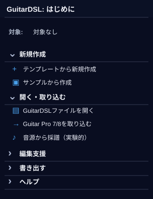

#### 1.2 GuitarDSL ファイル選択時

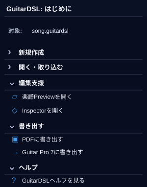

対象行にアクティブな GuitarDSL ファイル名を表示する。図では「編集支援」「書き出す」「ヘルプ」を展開し、アクティブなファイルに対する Preview / Inspector / PDF / Guitar Pro 7 の導線を示す。

アクティブなエディタが別文書へ切り替わったときに、区分の展開状態を強制変更しない。対象を使う Preview / Export 操作は、項目を押した時点のアクティブエディタだけを使う。

#### 1.3 項目・コマンド・対象

| 区分・項目 | コマンド | 対象と動作 |
|---|---|---|
| 新規作成・テンプレートから新規作成 | `guitardsl.newDocumentFromTemplate` | 選択したテンプレートから新しい未保存文書を作成する |
| 新規作成・サンプルから作成 | `guitardsl.openSample` | 選択した同梱サンプルから新しい未保存文書を作成する |
| 開く・取り込む・GuitarDSL ファイルを開く | `guitardsl.navigation.openGuitarDslFile`（内部コマンド） | `.guitardsl` / `.gdsl` だけを選び、通常の TextEditor で開く |
| 開く・取り込む・Guitar Pro 7/8 を取り込む | `guitardsl.importGuitarPro` | 既存の Guitar Pro 取り込み処理を使う |
| 開く・取り込む・音源から採譜 | `guitardsl.navigation.chooseTranscriptionSource`（内部コマンド） | YouTube またはローカル WAV を選ぶ。Esc ではどちらも実行しない |
| 編集支援・楽譜 Preview を開く | `guitardsl.navigation.showPreviewActive`（内部コマンド） | 実行時にアクティブな GuitarDSL 文書を明示する。対象なしでは何も出力しない |
| 編集支援・Inspector を開く | `guitardsl.openInspector` | 既存 Inspector の対象解決と空状態を使う |
| 書き出す・PDF に書き出す | `guitardsl.navigation.exportPdfActive`（内部コマンド） | 実行時にアクティブな GuitarDSL 文書だけを `guitardsl.exportPdf` に渡す |
| 書き出す・Guitar Pro 7 に書き出す | `guitardsl.navigation.exportGuitarProActive`（内部コマンド） | 実行時にアクティブな GuitarDSL 文書だけを `guitardsl.exportGuitarPro` に渡す |
| ヘルプ・GuitarDSL ヘルプを見る | `guitardsl.openHelp` | 同梱ヘルプを開く |

サイドバーの項目・更新条件は [拡張機能仕様 §4C](extension.md) を参照する。

### 2. 楽譜 Preview

Preview は、再生操作、楽譜設定、譜面の順に表示する。ページ表示と連続表示は同じサンプル楽譜を異なるレイアウトで示す。練習モードが有効な状態では、楽譜設定行の下に練習操作行を加える。

#### 2.1 ページ表示

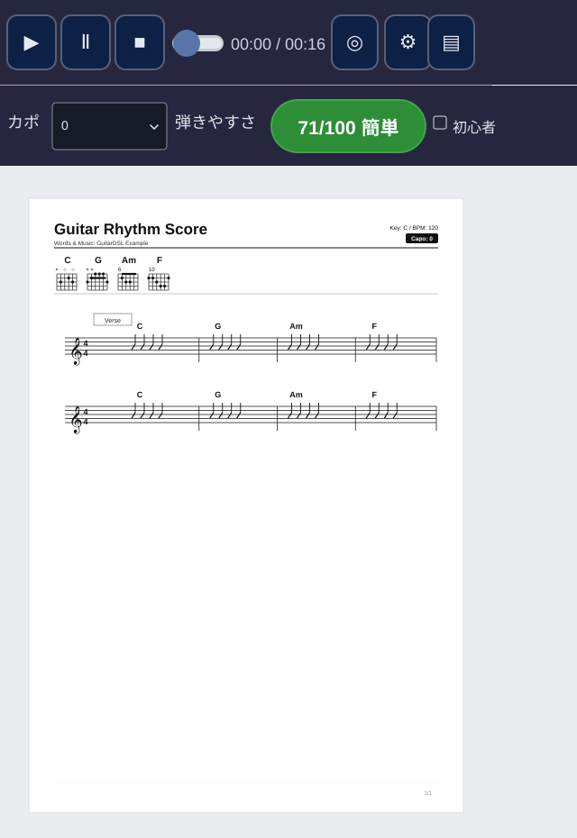

| 上からの順序 | 要素と表示仕様 |
|---:|---|
| 1 | 再生行。再生、一時停止、停止、再生位置、経過時間 / 総時間、ループ、設定、表示切替を配置する。 |
| 2 | 楽譜設定行。カポ選択、弾きやすさスコア「71/100 簡単」、初心者切替を配置する。 |
| 3 | 1ページの白い譜面面。曲名「Guitar Rhythm Score」、作者、キー C、BPM 120、カポ 0 を上部に表示する。 |
| 4 | 譜面上部のコードダイアグラム列。C、G、Am、F の図と運指を表示する。 |
| 5 | セクション「Verse」と五線譜2段を表示し、各段に C、G、Am、F のコード進行を配置する。 |
| 6 | ページ下端にページ番号 1/1 を置く。 |

#### 2.2 Web 連続表示

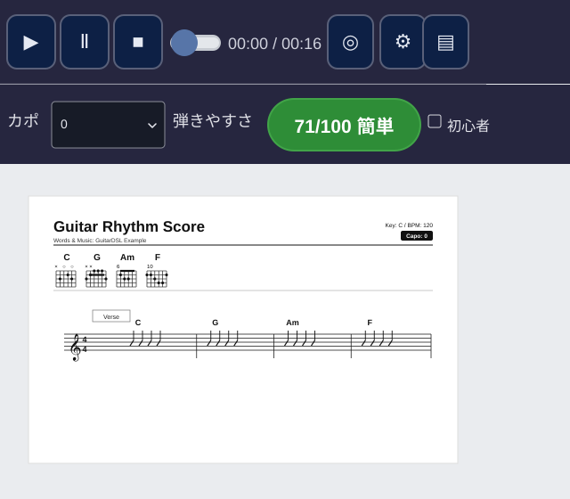

ページ表示と同じ再生行・楽譜設定行を譜面の上に置く。譜面は紙面ごとに区切らず連続レイアウトとし、曲名、作者、キー / BPM / カポ、コードダイアグラム、Verse、サンプル文書の五線譜2段をすべて図に含める。ページ境界とページ番号は表示しない。

#### 2.3 Practice 有効

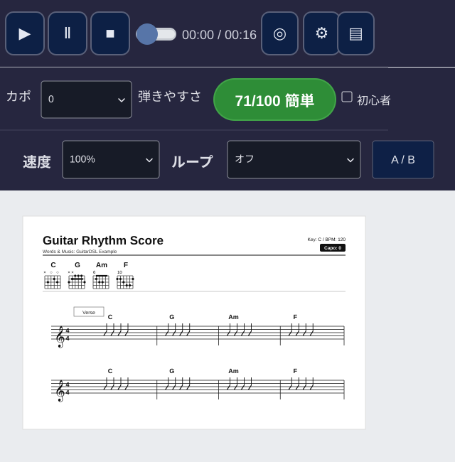

再生行と楽譜設定行の次に Practice 行を表示する。Practice 行には速度 100%、Loop オフ、A / B 操作を置く。その下にページ表示と同じサンプル楽譜の全表示内容を置き、2段の五線譜まで含める。Practice の選択状態や再生位置を譜面データの一部として描かない。

再生と Practice の操作意味は [拡張機能仕様 §4.2、§4.6、§4.7](extension.md) を参照する。

#### 2.4 弾き語り練習ガイド (Issue #153)

Practice が有効なとき、既存の再生行、楽譜設定行、Practice 操作行とページ表示を保持し、Preview の下端に固定された練習ガイドを表示する。ガイドは演奏位置を自動追従し、表示範囲が変わっても全曲から決めた基本分割を保つ。ガイドの折りたたみは表示だけを変え、再生状態を変えない。

ガイド本文は全曲を一度に表す連続時間軸とし、小節ごとのカードを作らない。左に一組だけの固定ラベル列、中央に横スクロールする時間軸、右に固定した次コード欄を置く。メロディ、歌詞、奏法、コード名、コード図の各レーンは同じ score-time-to-x 座標を使い、小節境界を各レーンで縦にそろえる。水平スクロールは時間軸だけに適用し、Preview の譜面やページを動かさない。メロディ行を表示する設定では、メロディ→歌詞→奏法→コード名→コード図の順に並べる。メロディ OFF はメロディ行だけを除き、他の行と歌詞同期を維持する。

色はテーマ追従の暗色面にせず、承認済み練習ガイド画像に合わせる。パネル面と奏法・コード名・コード図のレーンおよび固定欄は白 (`#ffffff`)、ヘッダーは `#243953`、メロディ面は `#173149`、歌詞面は `#1b344d` とする。時間軸内のコード図カードと次コード図カードは白に `#d2dde9` の境界を付ける。細分拍の背景グリッド線は表示せず、小節境界と再生ヘッドだけを時間位置の線として表示する。コード図のフレットボード中央はコード名の中央と一致させる。

メロディは音符の書かれた Fraction 開始・終了位置と音高を使い、音価に比例した横幅と音高に応じた縦位置の矩形バーで表す。同時音は各音高のバーを表示し、休符は有音バーと区別する。歌詞の各音節は対応するメロディ音符の開始・終了位置に置き、伸長記号の音節は後続音符の範囲まで延ばす。小節単位の旧形式歌詞はその小節全体に対応させる。再生中の音符・音節・奏法イベントをそれぞれハイライトする。

既存の `PlaybackPosition` / `PlaybackOccurrence` が表すスコア時刻を練習ガイド唯一の時計とする。同じ score-time-to-x 変換で5レーンに一本の縦再生ヘッドを投影し、再生、一時停止、Seek、速度変更、Loop 折返しで位置とイベントのハイライトを同期する。右側の次コード欄は時間軸スクロールの外に置き、現在時刻から次のコード名と図を更新する。幅421 CSS pxでも次コード名を常時見える状態にする。図の詳細は折りたためる。

16分の論理スロットは20 CSS px以上とし、基準倍率を4分音符あたり80 CSS pxとする。表示範囲には基準倍率のまま入る完全な小節をできるだけ多く表示し、4/4では幅1100 CSS pxに最低2小節、1400 CSS pxに最低3小節を表示する。狭い幅では見える範囲だけを表示して時間軸を横スクロールし、再生追従で現在位置を表示範囲内へ移す。`PM↓`、`×↓`等の複合ラベルが衝突する場合だけ全レーン共通の時間軸幅を拡張する。奏法の攻撃・継続記号は14 CSS px以上とし、隣接する文字を重ねない。休符は音価に合う音楽休符、弦攻撃は弦番号だけ、パームミュートはまとまった `PM↓` / `PM↑` とする。空振りを表示せず、`〜` は書かれた音価または有効なタイの継続だけに使う。

時間軸内のコード図は160 × 90 CSS pxで描き、コード名を直上のレーンに置く。コード図レーンは最低112 CSS pxとし、図を切らない。歌詞は音節の記譜位置を保ち、演奏済み・現在・次の状態を視覚的に区別する。通常の音節は18 CSS px、現在音節は24 CSS pxとする。メロディバーは高さ12 CSS px以上とし、上下の音高ガイド、高低の位置、演奏済み・現在・次の音を区別する。16分表示中は、奏法イベント内の継続スロットを再生するときも現在マーカーを同時に複数強調しない。

視覚検収は幅421 / 600 / 840 / 1100 / 1400 CSS px、日英、ライト / ダーク、メロディ ON / OFF の全組合せで行う。全40画面に同じ長い音節歌詞・16分奏法・F/G/Em7/Am/Dm7コード図を使い、DOMの可視性、内接、レーン間の拍位置、文字の非重複、メロディ音価バーと音高ガイド、歌詞の演奏済み・現在・次の状態、16分スロットの逐次強調、次コード欄の固定表示および記号を確認する。再生位置・表示倍率・テーマ・幅をそろえた実 Preview 画像を本仕様の承認済み画面と照合する。コード図は6本の弦を横線、フレット区切りを縦線とし、1弦を上、6弦を下、開放弦とミュート弦の記号を左に置く。コード図と次のコード欄を下端・右端で切らない。

展開パネルの高さは viewport の割合で固定せず、header と、左ラベル列・中央レーン群・右次コード欄の実際の高さの最大値および意図した padding から自然に決める。viewport 高さが700 CSS px以上なら、既存ツールバーの下に Preview 譜面の可視領域を160 CSS px以上残す。700 CSS px未満では `max(80px, 20% viewport height)` を譜面用に確保し、収まらないパネル本文全体だけを縦スクロールさせる。header は表示したままにし、横スクロールは中央時間軸だけに適用する。`body` の下端余白はパネルの実測 border-box 高さに合わせ、Preview の再構築、viewport resize、メロディ / コード図の ON/OFF、折りたたみで更新する。折りたたみ時は高さ42 CSS pxとし、タイトルと展開操作だけを表示する。

コード名と対応するコード図は同じ幅160 CSS pxの配置箱を共有し、コード名を図の中央に配置する。先頭・末尾の画面端調整は共通配置箱に適用し、各コード名と図の中心差を2 CSS px以内にして、相互の重なりと端切れをなくす。視覚検収では承認済み参照画像と実 Preview 画像を同一 DSL・再生位置・幅・テーマで比較し、差分を `layout` / `color` / `size` / `alignment` / `clipping` に分類した表を記録する。E2E の成功や画像ファイルの生成だけを視覚適合の根拠にしない。

奏法行は攻撃位置に方向、方向のない攻撃は中立記号 `●`、ブラッシング、パームミュートまたは弦番号を置く。音価と有効なタイの継続位置には `〜` を表示し、タイの継続符は再攻撃しない。消音位置には `・`、休符位置には音価別休符を表示し、消音・休符・ブラッシング・スタッカートから持続や空振りを推測しない。手動表示分割は4分・8分・16分のみで、DSL と音響を変更しない。Preview 文書ごとに一時状態として保持する。

### 3. GuitarDSL Inspector

Inspector は対象文書がない状態と、文書に応じた設定画面を同じ領域に表示する。設定画面はタブ、説明または入力、結果、確定操作の順に構成する。

#### 3.1 対象文書なし

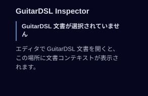

見出し「GuitarDSL Inspector」の下に、GuitarDSL 文書が選択されていない旨を2行で強調表示する。続けて、エディタで GuitarDSL 文書を開くとここに文書コンテキストを表示する説明を置く。別の開いている文書を暗黙に選択した表示は含めない。

#### 3.2 カポ / 弾きやすさ

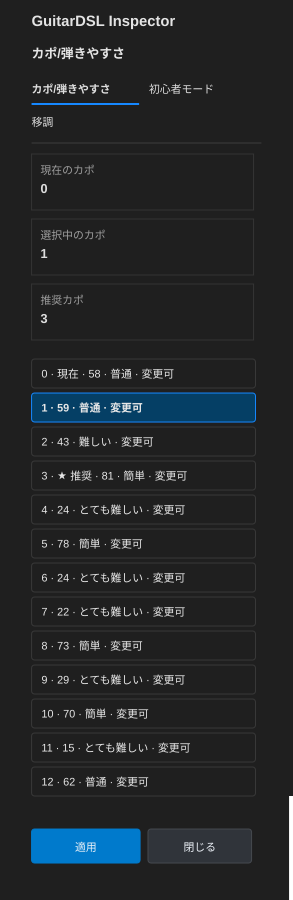

| 上からの順序 | 要素と代表表示 |
|---:|---|
| 1 | Inspector 見出しと設定タブ。「カポ/弾きやすさ」を選択し、「初心者モード」「移調」も同じタブ群に表示する。 |
| 2 | 現在のカポ 0、選択中のカポ 1、推奨カポ 3 の情報カード。 |
| 3 | カポ候補0〜12の全13行。各行に候補番号、弾きやすさスコア、難易度、変更可能状態を表示する。現在値0、選択値1、推奨値3を行内でも識別できるようにする。 |
| 4 | 候補一覧の後に「適用」「閉じる」を置く。 |

図の候補スコアは順に、58、59、43、81、24、78、24、22、73、29、70、15、62。難易度ラベルと変更可否は図に示すサンプル値である。

#### 3.3 初心者モード

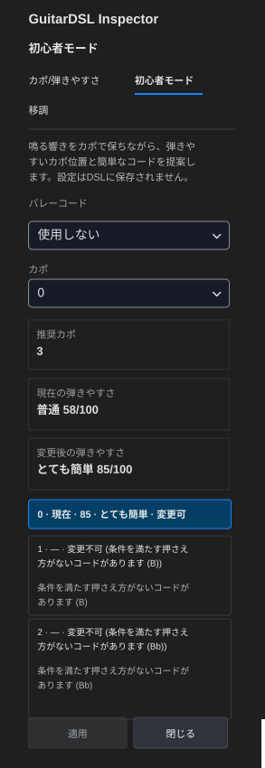

1. Inspector 見出しとタブ群を表示し、「初心者モード」を選択状態にする。
2. 鳴る響きをカポで保ちながら押さえやすい位置と簡単なコードを提案する説明を表示する。設定は DSL に保存されない旨も含める。
3. バレーコード方針「使用しない」、カポ 0、推奨カポ 3 の設定を縦に配置する。
4. 現在の弾きやすさ「普通 58/100」と変更後「とても簡単 85/100」を別の情報欄に置く。
5. 推奨カポ候補0〜2をすべて表示する。候補0は現在・変更可、候補1は B の押さえ方がないため変更不可、候補2は Bb の押さえ方がないため変更不可とし、理由文を候補に続けて表示する。
6. 一覧の後に「適用」「閉じる」を置く。

#### 3.4 移調

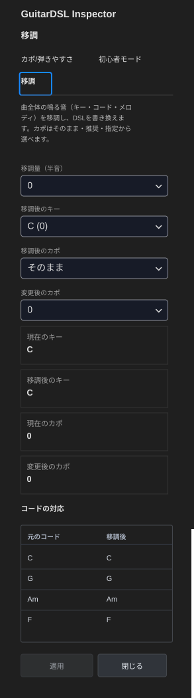

| 上からの順序 | 要素と代表表示 |
|---:|---|
| 1 | Inspector 見出しと3つの設定タブ。「移調」を選択状態にする。 |
| 2 | 曲全体の鳴る音を移調して DSL を書き換えること、カポを維持・推奨・指定から選べることの説明。 |
| 3 | 移調量 0 半音、移調後のキー C (0)、移調後カポ方針「そのまま」、変更後カポ 0 のコントロール。 |
| 4 | 現在のキー C / 移調後のキー C / 現在のカポ 0 / 変更後のカポ 0 の比較欄。 |
| 5 | コード対応表。元のコードと移調後を2列で示し、C→C、G→G、Am→Am、F→F の4行を置く。 |
| 6 | コード対応表の後に「適用」「閉じる」を置く。 |

#### 3.5 コード進行候補

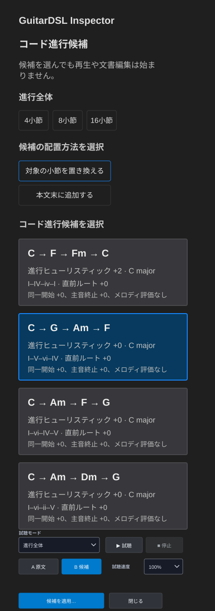

| 上からの順序 | 要素と代表表示 |
|---:|---|
| 1 | Inspector 見出し、画面見出し「コード進行候補」、候補の選択だけでは再生や文書編集が始まらないことを示す注意。 |
| 2 | 進行全体の長さ 4 / 8 / 16 小節と、配置方法「対象の小節を置き換える」「本文末に追加する」。 |
| 3 | 候補カード4枚。各カードにコード列、進行ヒューリスティックのスコアとキー、ローマ数字による進行名、評価根拠を表示する。 |
| 4 | 候補カードの後に試聴モード「進行全体」、試聴、停止、A 原文 / B 候補、試聴速度 100% を置く。 |
| 5 | 最下部に「候補を適用…」「閉じる」を置く。 |

候補カードの順序とコード列は、C→F→Fm→C、C→G→Am→F、C→Am→F→G、C→Am→Dm→G。図では2番目を選択状態にする。各カードには表示したスコアと調性、進行のローマ数字、同一開始・主音終止・メロディ評価の注記を含める。候補4枚と最下部の操作までを1枚の図に含め、スクロール領域の途中で切らない。

Inspector の設定・候補操作の意味は [拡張機能仕様 §4B、§4D](extension.md) を参照する。

### 4. コード図エディタ

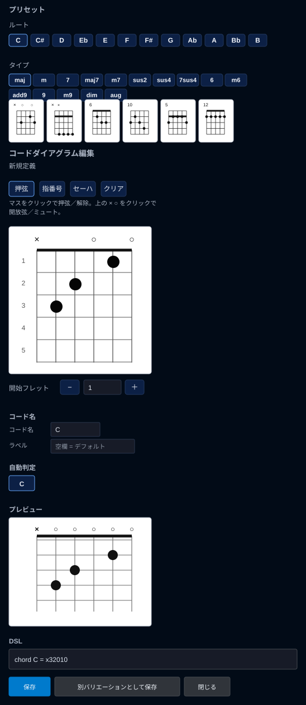

コード図エディタは上からプリセット、運指編集、コード情報、プレビュー、DSL 出力、保存操作の順に構成する。図には下記すべてを含む。

| 上からの順序 | 要素と代表表示 |
|---:|---|
| 1 | 「プリセット」見出し。「ルート」は C、C#、D、Eb、E、F、F#、G、Ab、A、Bb、B の12音を選べる。「タイプ」は maj、m、7、maj7、m7、sus2、sus4、7sus4、6、m6、add9、9、m9、dim、aug を表示する。 |
| 2 | プリセット形状候補の小型ダイアグラム列。候補の開放弦 / ミュート、押弦位置、フレット情報を図示する。 |
| 3 | 「コードダイアグラム編集」と新規定義状態。操作モードは押弦、指番号、セーハ、クリア。マス目をクリックして押弦を切り替え、上端の × / ○ でミュート / 開放弦を指定する案内を置く。 |
| 4 | 6弦のフレットボードと上端の弦状態を表示する。サンプル運指は C の x32010。 |
| 5 | 開始フレットの −、値1、＋。 |
| 6 | コード名 C、ラベル入力、空欄ならデフォルトを使う説明、自動判定結果 C。 |
| 7 | 編集中のコードダイアグラムのプレビュー。 |
| 8 | DSL 出力行 chord C = x32010。 |
| 9 | 「保存」「別バリエーションとして保存」「閉じる」の3操作を図の最下部に表示する。 |

#### 4.1 コード図内の表示規則

フレットボードは6本の弦と複数のフレット位置を直交線で表す。押弦は黒丸と指番号、ミュート弦は ×、開放弦は ○ で表す。開始フレットの値はボード直下に置く。コード名・ラベル・プレビュー・DSL はフレットボードの後に続け、保存操作はすべての編集情報の後にまとめる。

コード図の編集動作と DSL 表記は [拡張機能仕様 §3.3](extension.md) を参照する。

### 5. YouTube 採譜パネル

画面はタイトル、実験的な注意、YouTube URL、キー状態とキー管理の開閉、詳細設定の開閉、開始ボタン、進捗またはエラーの順に並べる。採譜処理の境界は [拡張機能仕様 §3.4](extension.md) に従う。

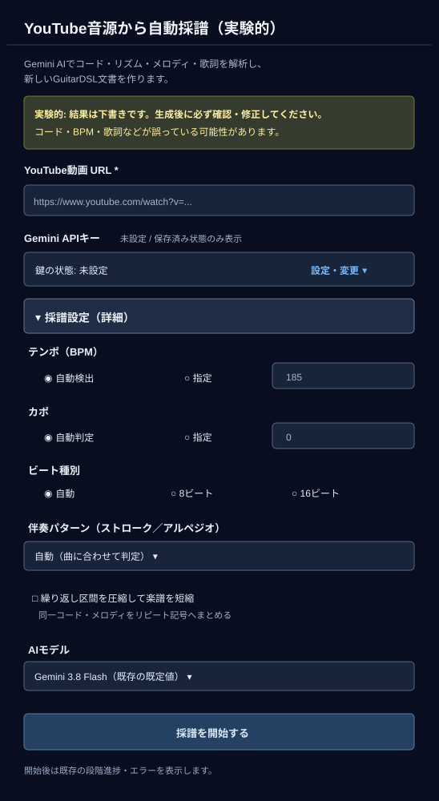

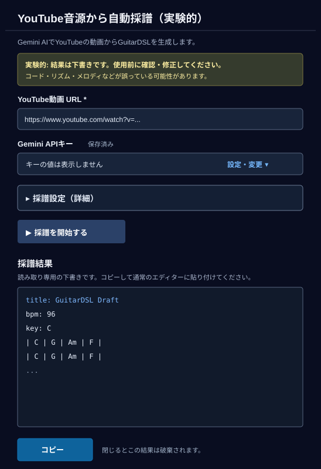

初期図はキー管理と詳細設定の両方を閉じ、URL とキーが未設定で開始ボタンを無効にした状態を示す。キー欄は管理を開いた場合だけ表示し、保存後は入力値を空に戻す。通常は未設定 / 保存済みの状態を示すが、SecretStorage の読み取りに失敗した場合はローカライズした「キー状態を確認できない」と表示し、どちらとも断定しない。キーの値は画面の状態表示、ログ、HTML に含めない。

詳細設定は BPM（自動 / 30–300 の手動値）、カポ（自動 / 0–12 の手動値）、ビート（自動 / 8 / 16）、伴奏ファミリーとプリセット、繰り返し圧縮、AI モデルの順に表示する。選択肢、既定値、既存コマンドへ渡す値は変えない。閉じた開閉領域の操作部品はキーボードフォーカス順に含めない。

開始ボタンは URL が空でなく、保存済みキーまたは入力キーがある場合だけ有効にする。URL の検証は拡張機能ホストが引き続き行う。開始後は二重実行を抑え、既存の段階進捗とエラーを同じパネルに表示する。Start 時の SecretStorage 読み取り失敗はローカライズしたエラーを表示して開始を復旧し、Gemini 呼び出しと文書生成を行わない。YouTube の実行中キャンセル操作は表示しない。

構造検証に成功した GuitarDSL は、このパネル内の読み取り専用欄に表示する。**コピー** 操作で通常の GuitarDSL エディターへ貼り付けて編集できる。採譜成功時にエディター文書は自動作成しない。パネルを閉じるとプレビューは破棄する。プレビュー表示、コピー操作、処理状態の同期は、Extension host からの message と Webview の応答に従う。

## Observable behavior

各図は見出しに記載した一つの代表状態を示す。スコア、コード、キー、選択行、候補数など文書や計算結果に応じて変わる値は、図のサンプル状態に限る。Preview の任意長譜面、別のキー・運指・候補、画面幅に応じた折り返し、読み込み中・エラー表示は、ここに示す図の寸法や代表値によって固定しない。

この仕様が規定するのは画面内の構成、表示順、情報のまとまりである。コマンド実行、文書変更、フォーカス、再生音、候補適用・取消の動作は [拡張機能仕様](extension.md) に従う。仕様と実装に差異がある場合、実装に合わせて既存の動作契約を変更せず、差異を Issue で解決する。

## Error and boundary behavior

入力検証、エラー表示、無効操作の扱いは [拡張機能仕様](extension.md) に従う。本書の SVG は明記した代表状態だけを示す。動的に増減する譜面・候補数・計算値や、読み込み・エラー時の全画面を一つの図で固定しない。

## Security and privacy

画面図に実在の API Key、個人の文書名、ユーザーデータを含めない。曲名、作者、コード、URL、API Key 欄の例は説明用の合成値またはプレースホルダーである。

## Verification strategy

画面仕様の図は SVG として XML 解析でき、`image` 要素やスクリーンショット画像の埋め込みを含まないことを確認する。SVG は各ファイルに記載した全寸法でベクターレンダラーを使って出力し、全13図を一覧表示して、対象画面の先頭から最下部の要素まで欠落がないことを確認する。Markdown の参照先と仕様書メタデータは `python3 -m agent_workflow validate-docs --issue 150` で検証する。
