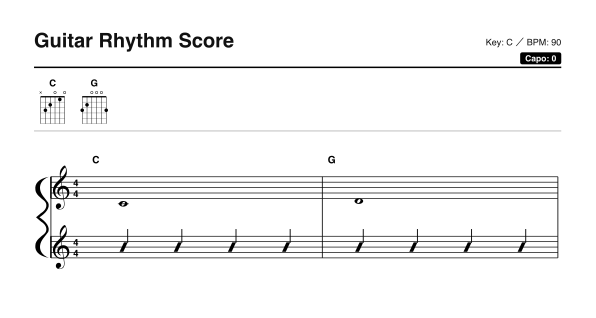
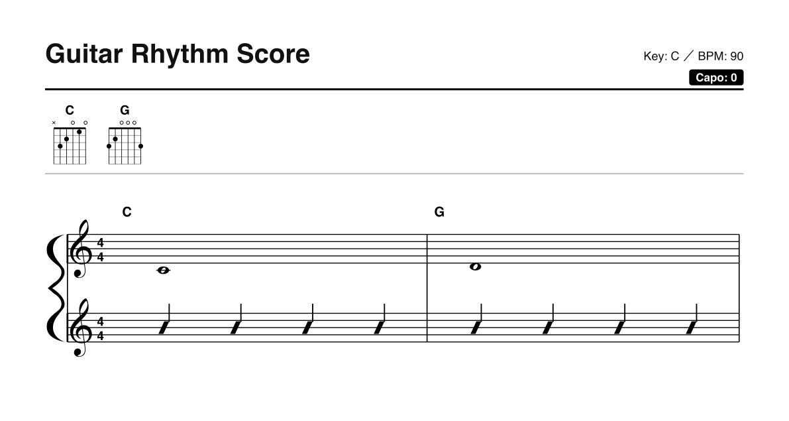
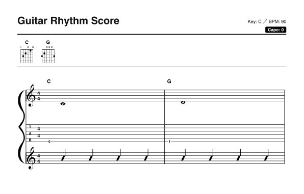
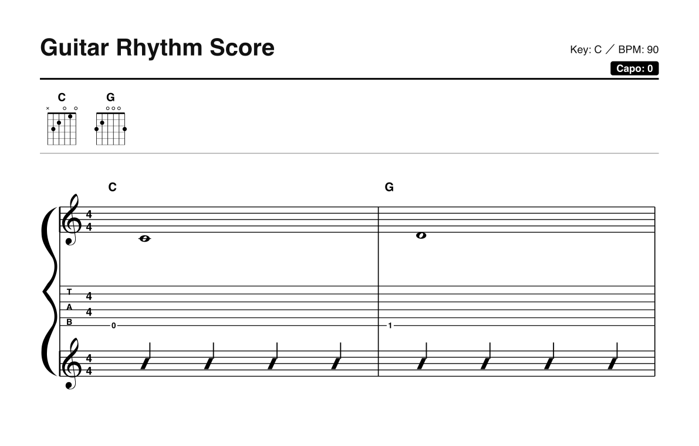
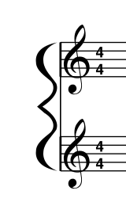
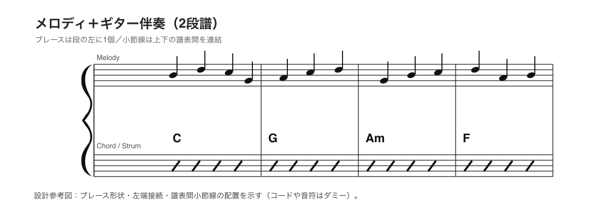

# Issue #160 visual evidence

The two-staff and three-staff examples were generated from the compiled renderer and rasterized from its continuous Preview SVG at 100% and 200%. The close-up is a crop from the two-staff 200% render. The reference image was rasterized independently from the [Issue #160 brace reference SVG](../../../specs/gui_design/proposals/issue-160/standard-brace-reference.svg), so the implemented render and canonical shape can be compared side by side. Page SVG and PDF renders were also visually checked at 200%; both preserve the same smooth filled contour. The brace keeps a fixed horizontal width while scaling vertically for each staff group.

## Two-staff system

## Three-staff system

## Magnified brace

## Reference shape

