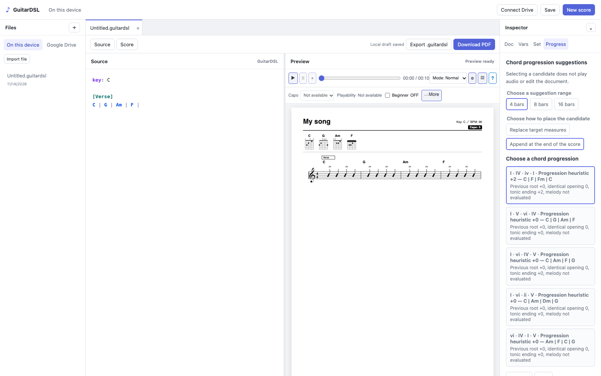
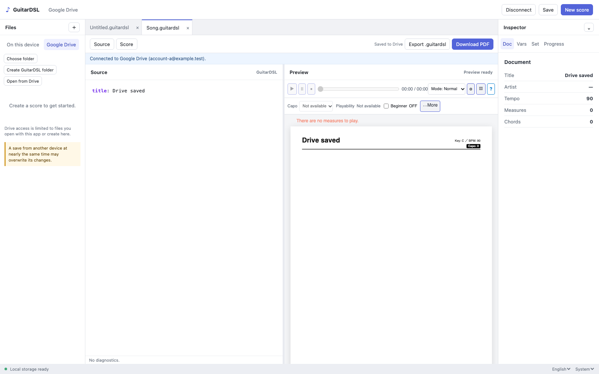

# Issue #166 Web SPA evidence

## English desktop workspace



Captured from the Chromium production E2E suite at 1600 × 1000 CSS pixels on macOS arm64 on 2026-11-13 from the implementation included in this PR update. The image shows the local-first workspace, syntax-highlighted source editor, rendered score, playback controls, and the shared Progression Inspector with range, replace/append, candidates, and audition controls. The tests also verify that highlighting leaves the native textarea as the source buffer, local edits preserve imported CRLF line endings, the initial local file appears once, all four compact Inspector tabs fit without horizontal scrolling, and Preview playback remains locked during an Inspector audition. Additional E2E cases cover the shared settings model and planner, variable editing and reference navigation, the shared chord diagram editor, per-tab Drive save state, and stale IndexedDB writers.

## Drive save warning



Captured from the Chromium production E2E suite at 1600 × 1000 CSS pixels on 2026-11-14. The Drive file list displays the accepted cross-device save race beside the existing access-scope note. The same suite verifies same-file PATCH saves, editing during a pending save, Ctrl/Cmd+S, preservation of drafts on an unconfirmed result or readback mismatch, and no automatic PATCH retry.

Recreate with:

```bash
GUITARDSL_CAPTURE_ISSUE166=1 npm run test:e2e --workspace web
```

The suite runs the workspace E2E cases in Chromium and Firefox. Only Chromium writes these screenshots.
