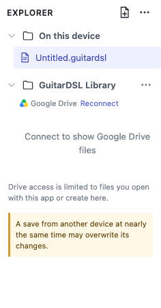
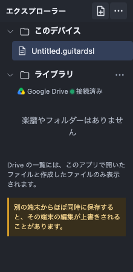

# Issue #180 — Google Drive library evidence

Captured on 2026-11-21. The original design preview is retained alongside rendered runtime screenshots from the Chromium E2E flow. Runtime screenshots use mocked Google OAuth and Drive APIs; they do not show a live account or production Drive session. Existing screenshots of the 220/236 px rows were captured before the Explorer root display label was shortened from `GuitarDSL Library` / `GuitarDSL ライブラリ` to `Library` / `ライブラリ`; the actual folder in Drive remains named `GuitarDSL`. Re-capture runtime evidence after the label-only change before final visual sign-off.

- [Rendered connection status row in English at 236 px Explorer width](library-connection-row-runtime.png)
- [Rendered connected row in Japanese dark theme at 220 px Explorer width](library-connection-row-connected-ja-dark-220-runtime.png)
- [Design preview — library setup and Drive root menu](library-setup.png)
- [Rendered setup dialog — mocked Drive](library-setup-runtime.png)
- [Rendered library root menu — mocked Drive](library-root-menu-runtime.png)
- Design source: [`docs/specs/gui_design/proposals/issue-180/`](../../../specs/gui_design/proposals/issue-180/)

Automated Chromium, WebKit, PWA, and Safari checks use mocked Google OAuth and Drive APIs. Live Google OAuth/Drive behavior was not exercised.
